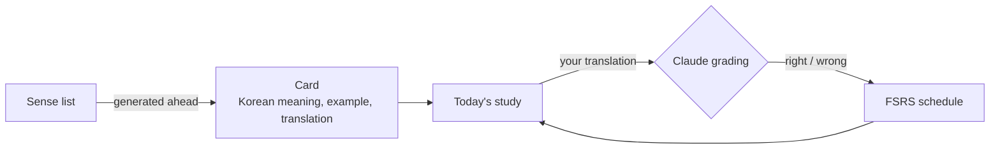

# Senseful

**Learn English words one sense at a time, by translating example sentences**

  
  
  
  

[한국어](README.md) · English

## How you study

<table>
  <tr>
    <td align="center" width="33%"> <b>1. Translate the sentence</b></td>
    <td align="center" width="33%"> <b>2. AI grades the meaning</b></td>
    <td align="center" width="33%"> <b>3. Reviews schedule themselves</b></td>
  </tr>
</table>

The app is for Korean speakers, so its screens are in Korean.

## Features

- 🧩 **One card per sense**: "to run (on foot)" and "to run (a business)" are different cards. Cards start from the easiest level (A1).
- 🤖 **AI grading**: different word order or tone is fine as long as the meaning matches. You can override a verdict right away, and an answer identical to the stored translation is accepted without an API call.
- 📅 **Automatic review schedule**: a spaced-repetition algorithm (FSRS) stretches the interval when you get a card right and brings it back in a few minutes when you miss it.
- ⚙️ **Your pace**: choose how many new cards a day (1–20) and which levels to skip.
- 📱 **Anywhere**: sign in with Google once and continue on your phone or computer. It is a beta with a daily grading limit.

## How it works

## Tech stack

| Area | Used |
| --- | --- |
| Web | Next.js 16 (App Router, Cache Components), React 19, Tailwind CSS 4 |
| DB | Neon Postgres, Drizzle ORM |
| Auth | Google OAuth 2.0 (PKCE, built in) + DB sessions |
| AI | Claude API (structured output): grading, card generation |
| Reviews | ts-fsrs |
| Tests | node:test (unit and integration on real Postgres), Playwright (E2E, desktop and mobile) |
| Deploy | Vercel (hosting, Web Analytics), GitHub Actions |

## Development

The app lives in [`web/`](web/). See [web/README.md](web/README.md) (Korean) for setup, tests and deployment.
