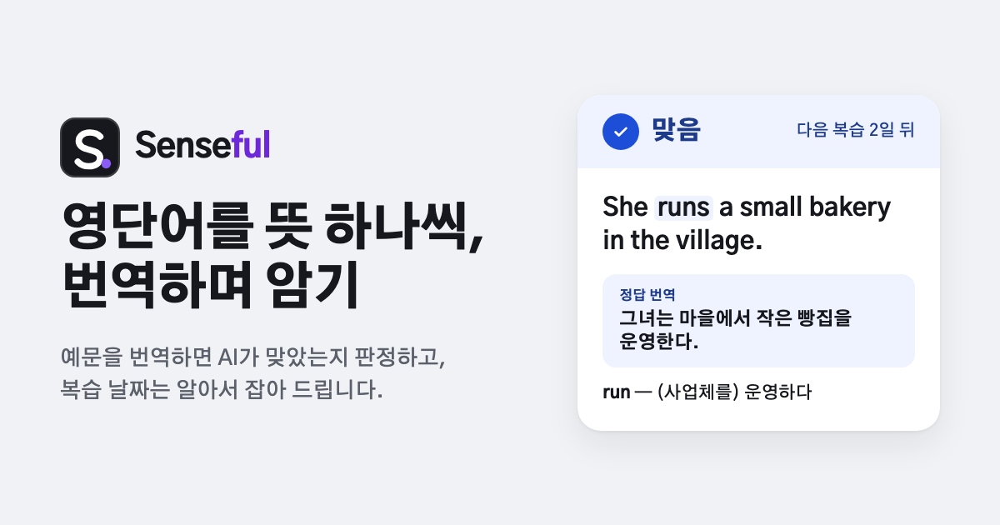
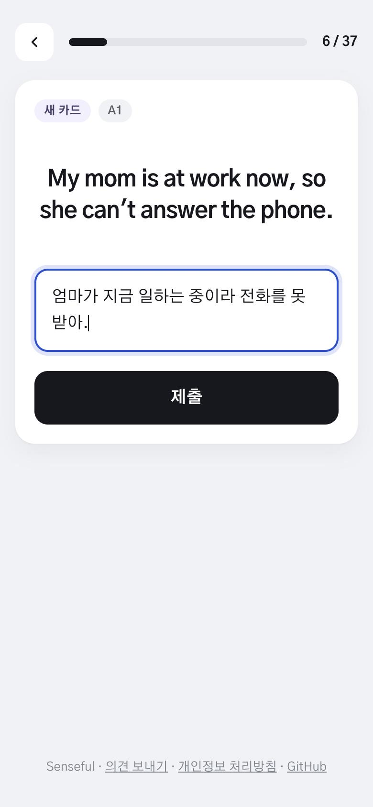
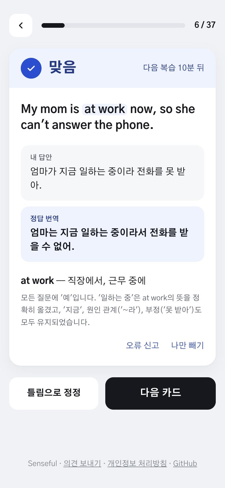
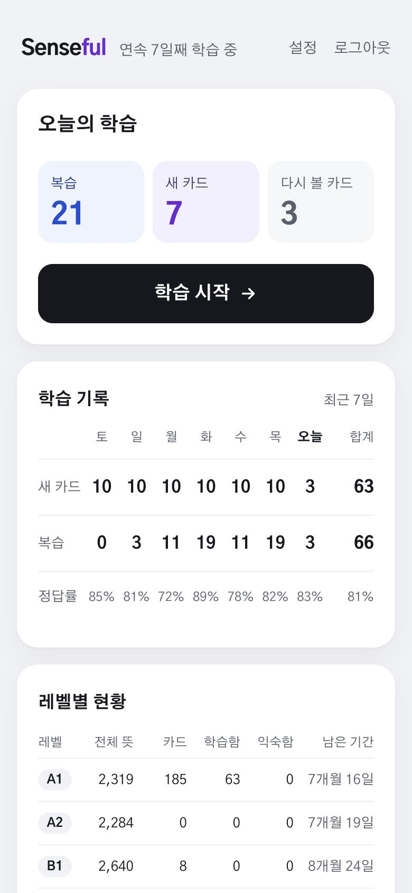
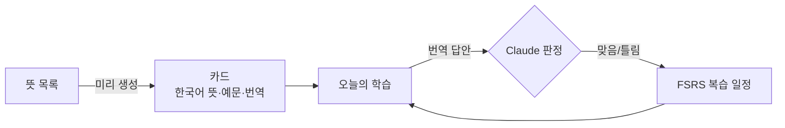

# Senseful

**영단어를 뜻 하나씩, 예문을 번역하며 암기합니다**

  
  
  
  

한국어 · [English](README.en.md)

## 이렇게 공부합니다

<table>
  <tr>
    <td align="center" width="33%"> <b>1. 예문을 번역합니다</b></td>
    <td align="center" width="33%"> <b>2. AI가 의미로 판정합니다</b></td>
    <td align="center" width="33%"> <b>3. 복습 날짜는 알아서</b></td>
  </tr>
</table>

## 특징

- 🧩 **뜻 단위 카드**: `run`의 "달리다"와 "(사업체를) 운영하다"는 서로 다른 카드입니다. 쉬운 레벨(A1)부터 나옵니다.
- 🤖 **AI 정답 판정**: 어순·말투가 달라도 뜻이 같으면 맞음입니다. 판정이 아쉬우면 바로 정정할 수 있고, 저장된 번역과 같은 답은 API 없이 맞음입니다.
- 📅 **복습 일정 자동 관리**: 간격 반복 알고리즘(FSRS)이 맞히면 간격을 늘리고, 틀리면 몇 분 뒤 다시 보여 줍니다.
- ⚙️ **내 학습에 맞게**: 하루 새 카드 수(1~20장)와 학습하지 않을 레벨을 정할 수 있습니다.
- 📱 **어디서나**: 구글 로그인 한 번으로 휴대폰과 PC에서 이어서 학습합니다. 하루 판정 횟수에 한도가 있는 베타입니다.

## 어떻게 동작하나요

## 기술 스택

| 영역 | 사용 |
| --- | --- |
| 웹 | Next.js 16(App Router, Cache Components), React 19, Tailwind CSS 4 |
| DB | Neon Postgres, Drizzle ORM |
| 인증 | 구글 OAuth 2.0(PKCE, 직접 구현) + DB 세션 |
| AI | Claude API(구조화 출력): 정답 판정, 카드 생성 |
| 복습 | ts-fsrs |
| 테스트 | node:test(단위·통합, 실제 Postgres), Playwright(E2E, 데스크톱·모바일) |
| 배포 | Vercel(호스팅, Web Analytics), GitHub Actions |

## 개발

앱 코드는 [`web/`](web/)에 있습니다. 설정·테스트·배포는 [web/README.md](web/README.md)를 봅니다.
